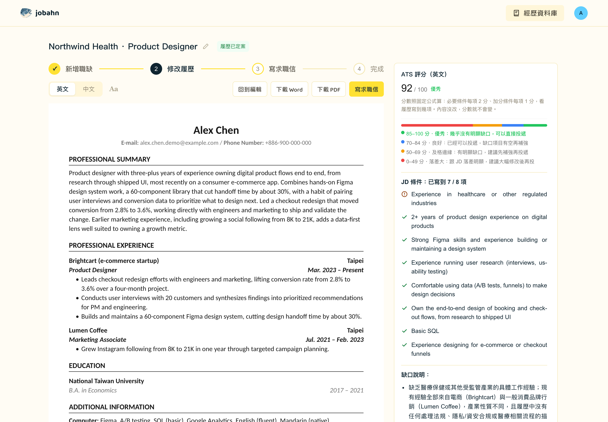
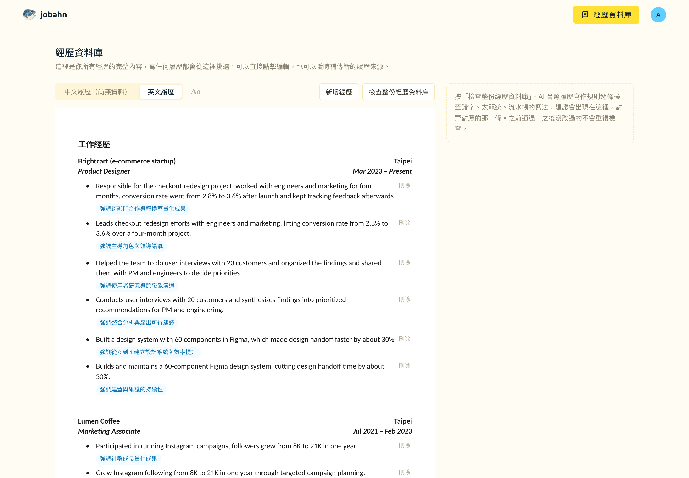
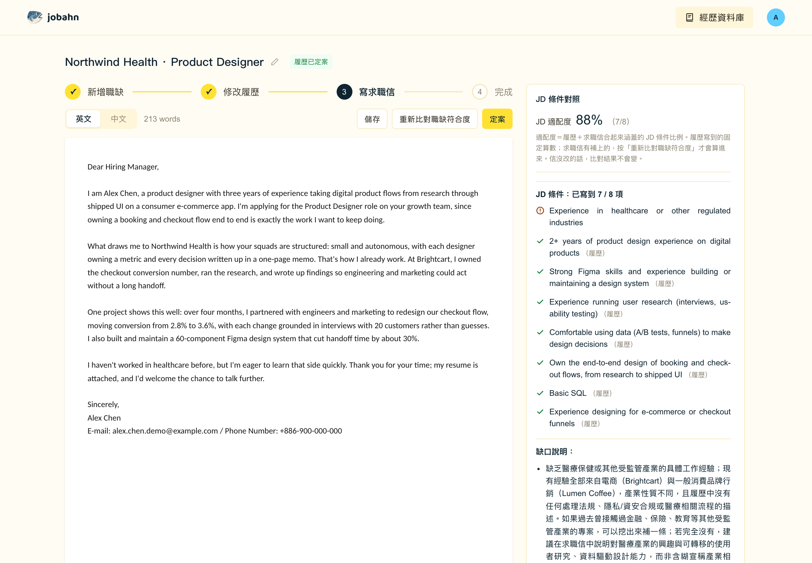

# jobahn

**An AI job-application assistant that turns what you've done into a resume that fits each job.**

You tell jobahn about your experience once (upload old resumes, or just type a sentence and let the AI ask follow-up questions). It keeps everything in an experience database. For every job description you paste in, it picks the most relevant experience, rewrites it to fit, scores it against the JD, and writes a matching cover letter, in English and Traditional Chinese.

[中文說明在下面](#中文說明)



## Features

- **Experience database.** Upload one or more resumes (docx / pdf), or start from nothing and type. The same accomplishment can be stored in several phrasings, and every finalized resume is written back, so the database gets richer over time.
- **AI follow-up questions.** Instead of asking you to write a polished bullet, the AI asks one question at a time (numbers, scope, your role, outcome) until there's enough to write one.
- **Resume per job description.** Picks and reorders experience for the JD, rewrites every bullet against a fixed set of writing rules, and never adds numbers or results that aren't in your data.
- **ATS checklist and score.** Lists the JD's requirements, marks which ones the resume covers, and explains each gap. The score is computed by a fixed formula (required ×2, nice-to-have ×1), so it doesn't drift between runs.
- **What-you-see-is-what-you-get editing.** Edit directly on an A4 page. Downloads (Word / PDF) use the same fonts, sizes and spacing.
- **Real one-page check.** Whether the resume fits on one page is measured on the actual PDF, not the screen. A red line shows where page 2 starts, and the AI can suggest what to cut. Body text size (9–12 pt) and vertical spacing are adjustable.
- **Cover letters.** Four-paragraph structure, optional word limit, and an optional web search for the company's culture (via Firecrawl) so the "why this company" paragraph is specific. It warns you if the company name you entered doesn't appear in the JD.
- **English and Chinese written natively**, each following its own resume conventions rather than being translated from the other.

| Experience database | Cover letter |
|---|---|
|  |  |

## Self-hosting

jobahn runs on your own computer with your own accounts. Nothing is sent to the author's servers.

### What you need

| | Required? | Notes |
|---|---|---|
| Node.js 20+ | Yes | |
| A [Supabase](https://supabase.com) project | Yes | Free tier is enough. Stores your data and handles login. |
| An AI provider | Yes, one of: | |
| ↳ [Claude Code](https://claude.com/claude-code) CLI, logged in | | `AI_PROVIDER=local-cli`. Uses your Claude subscription, no API key. Only works when running locally. Check that your plan's terms allow this kind of automated use. |
| ↳ An [Anthropic API key](https://console.anthropic.com) | | `AI_PROVIDER=api`. Pay per use. Needed if you deploy to a server. |
| A [Firecrawl](https://firecrawl.dev) API key | Optional | Enables "paste a job URL to fetch the JD" and "research the company before writing the cover letter" (about 4 credits per letter). Without it, both options are hidden. |

### Steps

1. **Clone and install**

   ```bash
   git clone https://github.com/znnh27/jobahn.ai.git
   cd jobahn.ai
   npm install
   ```

2. **Set up Supabase**
   - Create a project, open **SQL Editor**, and run the files in `supabase/migrations/` in order (`0001` → `0007`).
   - Go to **Authentication → Sign In / Providers → Email** and turn off **Confirm email**. Supabase's built-in email sending is limited to a few emails per hour, so sign-up confirmation emails won't arrive reliably. If you want email confirmation, configure your own SMTP provider under **Authentication → Emails** instead.

3. **Environment variables**: copy `.env.local.example` to `.env.local` and fill it in.

   | Variable | Where to find it |
   |---|---|
   | `NEXT_PUBLIC_SUPABASE_URL`, `NEXT_PUBLIC_SUPABASE_ANON_KEY` | Supabase → Project Settings → API |
   | `SUPABASE_SERVICE_ROLE_KEY` | Same page. Server-only, never expose it to the browser. |
   | `AI_PROVIDER` | `local-cli` or `api` |
   | `ANTHROPIC_API_KEY` | Only for `AI_PROVIDER=api` |
   | `FIRECRAWL_API_KEY` | Optional |
   | `DEV_ALLOWED_ORIGINS` | Optional. Your computer's LAN IP, if you want to open the dev server from your phone. |

4. **Run**

   ```bash
   npm run dev
   ```

   Open http://localhost:3000, sign up, and upload a resume (or type your first experience).

### Deploying (optional)

It's a standard Next.js app and deploys to Vercel or any Node host. Set `AI_PROVIDER=api` there, because a server has no logged-in Claude Code CLI. If other people will sign up on your instance, set up SMTP in Supabase (see step 2), and set a monthly spending limit in the Anthropic Console so a bug can't run up a large bill.

## How it's built

- **Next.js (App Router) + React**, server actions for everything that touches the database or AI.
- **Supabase**: Postgres with row-level security (each user only sees their own rows) and Auth.
- **AI calls** all go through one function, `src/lib/ai/askClaude.ts`, which switches between the Claude Code CLI and the Anthropic API, and logs token usage to the `ai_usage_log` table.
- **Documents**: PDF via `@react-pdf/renderer`, Word via `docx`. Fonts are Carlito (metric-compatible with Calibri) and Noto Sans TC, bundled under `public/fonts/`. Page size, font sizes and spacing come from one place, `src/lib/resumes/typography.ts`, shared by the on-screen canvas, the PDF and the Word file.
- **Writing rules** for resume bullets live in `src/lib/experience/bulletRules.ts` and are shared by the database check, the AI polish, and resume generation, so all three judge writing by the same standard.
- **Styles** are all in `src/app/design-system.css`. Components use semantic class names only. Visit `/design-system` while running the dev server to see every token and component.

### Checking AI usage

```sql
select provider, feature, count(*) as calls,
       sum(input_tokens) as input_tokens, sum(output_tokens) as output_tokens,
       round(sum(estimated_cost_usd)::numeric, 4) as est_cost_usd
from public.ai_usage_log
where created_at >= date_trunc('month', now())
group by provider, feature
order by est_cost_usd desc;
```

## License

[MIT](LICENSE)

---

## 中文說明

**jobahn 是一個找工作的 AI 助手：把你做過的事，寫成每個職缺都對得上的履歷。**

先把經歷交給 jobahn 一次（上傳舊履歷，或直接打一句話讓 AI 追問細節），它會整理成經歷資料庫。之後每貼一份 JD，它就從資料庫挑出最相關的經歷、照寫作規則改寫、對照 JD 評分，並寫一封搭配的求職信，中英文都可以。

### 功能

- **經歷資料庫**：上傳一份或多份履歷（docx／pdf），或從零開始直接打字。同一件事可以存好幾種寫法，每份定案的履歷都會寫回資料庫，越用越完整。
- **AI 追問**：不用自己寫出漂亮的句子，AI 一次問一題（數字、範圍、你的角色、成果），問到夠寫成一條 bullet 為止。
- **依 JD 客製履歷**：依職缺挑選、排序經歷，每一條都照固定的寫作規則改寫，不會加上資料裡沒有的數字或成果。
- **ATS 條件清單與分數**：列出 JD 的條件、標出履歷有沒有寫到、說明每個缺口。分數照固定公式算（必要條件 ×2、加分條件 ×1），同樣的內容分數不會變。
- **所見即所得編輯**：直接在 A4 紙上改，下載的 Word／PDF 用同一套字型、字級與間距。
- **真正的一頁檢查**：用實際下載的 PDF 判斷有沒有超出一頁，不是看螢幕。紅線標出第二頁從哪裡開始，也可以請 AI 建議刪哪些內容。內文字級（9–12pt）和上下間距可以調。
- **求職信**：四段式結構，可以設字數上限，也可以選擇先用 Firecrawl 上網研究公司文化，讓「為什麼想加入」寫得更具體。填的公司名稱沒出現在 JD 裡時會提醒你。
- **中英文各自照慣例寫**，不是互相翻譯。

### 自己架一份

jobahn 跑在你自己的電腦上，用你自己的帳號，資料不會經過作者的伺服器。

**需要準備**

| | 必要嗎 | 說明 |
|---|---|---|
| Node.js 20 以上 | 必要 | |
| 一個 [Supabase](https://supabase.com) 專案 | 必要 | 免費方案就夠，用來存資料和登入。 |
| AI（二選一） | 必要 | |
| ↳ 已登入的 [Claude Code](https://claude.com/claude-code) CLI | | `AI_PROVIDER=local-cli`，用你的 Claude 訂閱額度，不需要 API key，只能在本機執行。請自行確認你的方案條款允許這種自動化用法。 |
| ↳ [Anthropic API key](https://console.anthropic.com) | | `AI_PROVIDER=api`，用多少付多少，部署到伺服器時需要。 |
| [Firecrawl](https://firecrawl.dev) API key | 選填 | 開啟「貼職缺網址自動抓 JD」和「寫求職信前先研究公司」（每封信大約 4 credits）。沒設的話這兩個選項不會出現。 |

**步驟**

1. **下載並安裝**：`git clone` 這個 repo，進到資料夾後執行 `npm install`。
2. **設定 Supabase**
   - 建立專案，到 **SQL Editor** 依序執行 `supabase/migrations/` 裡的檔案（`0001` 到 `0007`）。
   - 到 **Authentication → Sign In / Providers → Email** 關掉 **Confirm email**。Supabase 內建的寄信服務每小時只能寄幾封，註冊驗證信不一定收得到。想保留信箱驗證的話，改到 **Authentication → Emails** 設定自己的 SMTP 寄信服務。
3. **環境變數**：把 `.env.local.example` 複製成 `.env.local` 並填好，各欄位說明見上方英文版的表格。
4. **啟動**：執行 `npm run dev`，打開 http://localhost:3000，註冊後上傳履歷（或直接打字輸入第一段經歷）就可以開始用。

**部署（選用）**：這是一般的 Next.js 專案，可以部署到 Vercel 或任何 Node 主機。伺服器上沒有登入的 Claude Code CLI，所以要設 `AI_PROVIDER=api`。如果會讓其他人在你架的網站註冊，記得照第 2 步設定 SMTP，並到 Anthropic Console 設定每月花費上限，避免程式出錯時產生大筆費用。

### 改樣式

全站樣式都在 `src/app/design-system.css`，元件裡只用語意化的 class 名稱。開發時打開 `/design-system` 可以看到所有顏色、字級、元件的即時預覽。履歷畫布、PDF、Word 的字級與間距都來自 `src/lib/resumes/typography.ts`，改這裡三邊會一起變。
